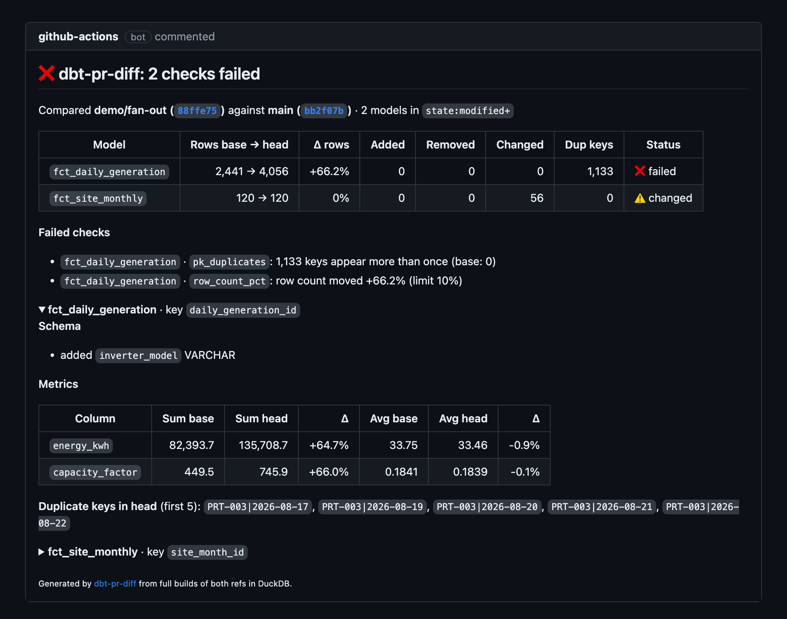
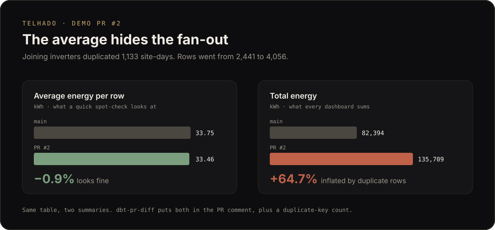
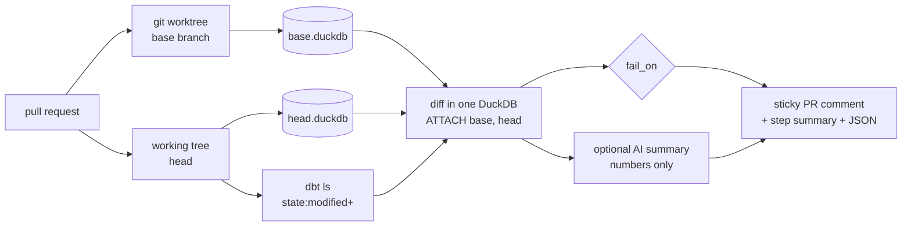

# dbt-pr-diff

A reviewer can read your SQL. Without help, they can't see that the join you added doubled the rows in `fct_daily_generation`.

dbt-pr-diff builds both sides of a dbt pull request in DuckDB, compares every model in `state:modified+`, and posts the numbers as one comment on the PR. That covers row counts, keys added, removed and changed, duplicate keys, schema changes, column null-rate and distinct-count shifts, and sums and averages of the columns you mark as metrics. A `fail_on` rule turns a grain break into a red check.

It is a GitHub Action and a CLI of about 1,000 lines with no server and no account. It pairs with the post [Reviewers can read your SQL. Show them the numbers.](https://goldlayer.dev/writing/data-pull-requests-show-the-numbers.html)

## What the comment looks like

This is the real comment on the [fan-out demo PR](https://github.com/PZawieja/dbt-pr-diff/pull/2), where a join to `stg_inverters` duplicates every site that has more than one inverter:



The average barely moves while the sum goes up 65%, which is why the comment shows both:



## How it works



1. **Build both sides.** It checks out the base branch in a `git worktree` and runs `dbt seed` and `dbt run` into `base.duckdb`, then does the same for the PR into `head.duckdb`. Tests are left to your normal CI, so a failing test can't hide the diff that explains it.
2. **Pick the models.** `dbt ls --select state:modified+` runs against the base manifest, so only changed models and everything downstream get compared.
3. **Find keys and metrics in your YAML.** The key is the column with a `unique` test, or `meta: {diff_key: [a, b]}` for composite keys. Metrics are columns with `meta: {diff_metric: true}`.
4. **Diff in SQL.** One DuckDB connection attaches both files. Rows are matched on the key and compared by a hash of their shared columns. Duplicate keys are counted on each side, so a grain break the PR introduces is separated from one that was already there.
5. **Post.** It writes one comment and updates it on every push instead of adding new ones. The same markdown goes to the job summary, and the full report is uploaded as `pr-diff.json`.

## Quickstart

### In GitHub Actions

```yaml
# .github/workflows/pr-diff.yml
name: pr-diff
on: pull_request
permissions:
  contents: read
  pull-requests: write
jobs:
  diff:
    runs-on: ubuntu-latest
    steps:
      - uses: actions/checkout@v4
      - uses: PZawieja/dbt-pr-diff@v0
        with:
          project-dir: .
          fail-on: pk_duplicates,removed_rows,row_count_pct>10
        env:
          ANTHROPIC_API_KEY: ${{ secrets.ANTHROPIC_API_KEY }}  # optional
```

| Input | Default | |
|---|---|---|
| `project-dir` | `.` | dbt project path |
| `base-ref` | the PR's base branch | branch to compare against |
| `select` | `state:modified+` | any dbt selector |
| `fail-on` | none | `pk_duplicates`, `removed_rows`, `added_rows`, `changed_rows`, `schema_change`, `row_count_pct>N`, `metric_pct>N` |
| `comment` | `true` | post the sticky comment |
| `dbt-duckdb-version` | latest | pin to match your project |

### Locally, before you open the PR

```bash
uvx --from git+https://github.com/PZawieja/dbt-pr-diff dbt-pr-diff compare \
  --base-ref main --project-dir path/to/dbt_project
```

It prints the same markdown, ready to paste under "What changes in the data" in your PR description.

### Try it on the demo project

```bash
git clone https://github.com/PZawieja/dbt-pr-diff && cd dbt-pr-diff
uv sync && uv run pytest -q
git switch demo/fan-out && uv run dbt-pr-diff compare --project-dir examples/telhado
```

## The demo

`examples/telhado` is a small dbt project for Telhado, a fictional rooftop-solar co-op in Portugal: 30 sites, their inverters, and 90 days of meter readings, generated by a seeded script. Four PRs stay open so you can read real comments:

| PR | What it does | Verdict |
|---|---|---|
| [#1 Safe refactor](https://github.com/PZawieja/dbt-pr-diff/pull/1) | Renames CTEs and reformats SQL | ✅ no data changes |
| [#2 Silent fan-out](https://github.com/PZawieja/dbt-pr-diff/pull/2) | Adds `inverter_model` by joining inverters without aggregating | ❌ duplicate keys, rows +66% |
| [#3 Filter drift](https://github.com/PZawieja/dbt-pr-diff/pull/3) | Lets `estimated` readings into the trusted daily table | ⚠️ rows added, null rate shifts |
| [#4 Capacity-factor fix](https://github.com/PZawieja/dbt-pr-diff/pull/4) | Divides by installed kW instead of peak kW | ⚠️ values change, rows don't |

## AI summary

If `ANTHROPIC_API_KEY` is set, Claude Haiku 5.5 reads the aggregates (never row samples) and writes three bullets: what changed, the biggest risk, and what to check by hand. The section is labeled as AI-written. Without a key, or on PRs from forks, which don't get secrets, the comment is the same minus that section.

## Limits

- DuckDB only. The diff SQL is portable, but the build step assumes DuckDB files. For a warehouse, point `--base-db` at an existing production copy, or use the tools below.
- It builds both sides in full. That takes seconds at demo scale and is the wrong choice for a large project (see [decisions](docs/decisions.md)).
- PRs from forks get a read-only token, so they get the job summary instead of a comment.

## Prior art

- [Recce](https://github.com/DataRecce/recce) is the most complete open-source option: an interactive server with lineage diff, profile diff, query diff and checklists. If your team wants a review UI, use it.
- [datafold/data-diff](https://github.com/datafold/data-diff) did fast cross-database diffs. It was archived in May 2024; forks such as reladiff continue it.
- dbt Cloud's "compare changes" does this inside dbt Cloud CI.
- [dbt-audit-helper](https://github.com/dbt-labs/dbt-audit-helper) has macros for comparing two relations by hand.

dbt-pr-diff takes a narrower position: comment first, no infrastructure, opinionated failure rules, and code short enough to read in one sitting.

## Development

```bash
uv sync --all-extras
uv run pytest -q                       # unit tests + two end-to-end runs
uvx ruff check . && uv run sqlfluff lint examples/telhado/models
python examples/telhado/scripts/generate.py   # regenerate seeds
```

Design notes are in [docs/decisions.md](docs/decisions.md). MIT licensed.
